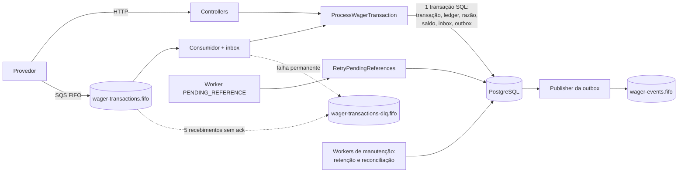

# Arquitetura

Este documento é o mapa do sistema: o que ele garante, como as peças se encaixam e onde cada coisa está no código. O detalhe de cada assunto está em [`docs/design/`](docs/design/), o porquê de cada decisão em [`docs/adr/`](docs/adr/) e o contrato público em [`docs/api/`](docs/api/). Para subir o ambiente, veja o [README](README.md).

## Visão geral

HTTP, SQS e o worker de referências pendentes aplicam **a mesma regra de domínio**. Toda alteração financeira, o registro de inbox e os eventos de integração são gravados na **mesma transação SQL**; nada é publicado antes do commit. O serviço é stateless: qualquer número de instâncias roda ao mesmo tempo sobre o mesmo banco e as mesmas filas.

## Garantias

| Garantia                                                               | Como                                                                               | Detalhe                                                                      |
| ---------------------------------------------------------------------- | ---------------------------------------------------------------------------------- | ---------------------------------------------------------------------------- |
| Saldo exato, sem ponto flutuante                                       | `Money` em centavos com `bigint`; entrada só como string decimal                   | [money.md](docs/design/money.md)                                             |
| Nenhuma atualização perdida entre instâncias                           | `SELECT ... FOR UPDATE` por wallet; sem lock global                                | [concurrency-and-idempotency.md](docs/design/concurrency-and-idempotency.md) |
| Reenvio nunca debita duas vezes                                        | chave de idempotência + hash canônico do payload, `UNIQUE` no banco, inbox na fila | [concurrency-and-idempotency.md](docs/design/concurrency-and-idempotency.md) |
| Saldo, ledger e razão nunca divergem                                   | `CHECK`, triggers e constraint triggers deferidas verificadas no COMMIT            | [persistence.md](docs/design/persistence.md)                                 |
| Débitos = créditos                                                     | razão de partidas dobradas com balanceamento garantido pelo banco                  | [persistence.md](docs/design/persistence.md#partidas-dobradas)               |
| Nenhum evento perdido ou de algo que sofreu rollback; ordem por wallet | transactional outbox com claim por wallet e `SKIP LOCKED`                          | [messaging.md](docs/design/messaging.md)                                     |
| Mensagem só sai da fila depois do commit                               | `DeleteMessage` após o commit; inbox reconhece redelivery                          | [messaging.md](docs/design/messaging.md)                                     |
| `REFUND`/`ROLLBACK` antes da referência se resolvem sozinhos           | estado `PENDING_REFERENCE` com worker e backoff                                    | [business-rules.md](docs/design/business-rules.md)                           |
| Divergências são detectadas, mesmo sem ninguém consultar               | reconciliação periódica de todas as wallets, com alerta                            | [observability.md](docs/design/observability.md#reconciliação)               |

## Camadas

| Camada           | Depende de | Conteúdo                                                                                                                                                                                       |
| ---------------- | ---------- | ---------------------------------------------------------------------------------------------------------------------------------------------------------------------------------------------- |
| `domain`         | nada       | `Money`, `Wallet`, `WagerTransaction`, `WagerSettlement`, ledger, razão, eventos, inbox/outbox                                                                                                 |
| `application`    | `domain`   | casos de uso e ports (`TransactionRunner`, `WageringUnitOfWork`, `WageringQueries`, `OutboxStore`, `MaintenanceStore`, `EventPublisher`, `Clock`, `IdGenerator`, `Telemetry`, `TokenVerifier`) |
| `infrastructure` | todas      | adapters: MikroORM, SQS, JWT, logs JSON, Prometheus, OpenTelemetry, polling workers                                                                                                            |
| `interfaces`     | todas      | controllers HTTP, consumidor SQS, ciclo de vida dos workers                                                                                                                                    |

O domínio não conhece Nest, ORM nem Bun. Entidades têm construtor privado e factories (`create`/`open`/`from` validam; `rehydrate` só reconstrói estado persistido). IDs e relógio são injetados, o que torna o domínio determinístico e testável sem I/O. A ligação entre ports e adapters está toda em `src/app.module.ts`. Ver [ADR 0002](docs/adr/0002-ports-and-adapters-with-a-pure-domain.md).

## Mapa do código

| Caminho                                               | O que tem                                                                                   |
| ----------------------------------------------------- | ------------------------------------------------------------------------------------------- |
| `src/domain/money/`                                   | `Money` e seus erros                                                                        |
| `src/domain/wallet/`                                  | agregado `Wallet` (saldo, versão, débito e crédito)                                         |
| `src/domain/wagering/`                                | `WagerTransaction` (máquina de estados), `WagerSettlement` (regras por tipo), `FailureCode` |
| `src/domain/ledger/`                                  | lançamento do ledger da wallet, `JournalEntry` e `LedgerAccount` (partidas dobradas)        |
| `src/domain/events/`, `src/domain/messaging/`         | eventos de integração, `InboxMessage`, `OutboxMessage`                                      |
| `src/application/wagering/`                           | `ProcessWagerTransaction` (o caminho principal), `RetryPendingReferences`, hash de payload  |
| `src/application/wallets/`, `ledger/`                 | abertura de wallet, ledger paginado, reconciliação sob demanda, balancete                   |
| `src/application/messaging/`                          | `PublishOutboxEvents`                                                                       |
| `src/application/maintenance/`                        | `PurgeExpiredMessages` (retenção) e `ReconcileAllWallets` (reconciliação periódica)         |
| `src/application/ports.ts`, `telemetry.ts`, `auth.ts` | interfaces que a infraestrutura implementa, e as regras de autorização                      |
| `src/infrastructure/persistence/`                     | records, mappers, Unit of Work, consultas SQL e `migrations/`                               |
| `src/infrastructure/messaging/`                       | cliente SQS e publisher de eventos                                                          |
| `src/infrastructure/observability/`                   | logger JSON, contexto de log, Prometheus, OpenTelemetry                                     |
| `src/infrastructure/auth/`                            | verificação de JWT contra o JWKS do Keycloak                                                |
| `src/infrastructure/workers/`                         | `PollingWorker`, o laço genérico dos workers                                                |
| `src/interfaces/http/`                                | controllers, guard de autenticação, filtro de erros, validação zod, `/docs`                 |
| `src/interfaces/sqs/`                                 | consumidor da fila de entrada (inbox, ack, DLQ, backoff)                                    |
| `src/interfaces/workers/`                             | início e parada ordenada de todos os workers                                                |
| `docs/api/openapi.yaml`                               | contrato HTTP, servido em `/docs`                                                           |
| `docker/`                                             | init do Postgres e das filas, realm do Keycloak, Prometheus, alertas e Grafana              |
| `test/`, `load-test/`                                 | ver [testing.md](docs/design/testing.md)                                                    |

## Caminho de uma transação

1. **Entrada.** `WageringController` (HTTP) ou `WagerTransactionConsumer` (SQS) valida o formato com zod e monta o comando. No HTTP, o `AuthGuard` já validou o token e o papel.
2. **Caso de uso.** `ProcessWagerTransaction` calcula o hash do payload e abre a transação SQL. Procura a chave de idempotência; se achar, devolve replay ou conflito.
3. **Lock.** Garante a conta contábil da casa, trava a wallet com `SELECT ... FOR UPDATE` e repete a busca de idempotência.
4. **Decisão.** `WagerSettlement`, puro, decide: aplica, rejeita ou deixa pendente de referência.
5. **Gravação.** Transação, lançamento do ledger, lançamento contábil, saldo, inbox e eventos na outbox, num único flush. No COMMIT, os triggers deferidos conferem as invariantes.
6. **Resposta.** O HTTP responde com o status do resultado; o consumidor SQS só então apaga a mensagem.
7. **Depois do commit.** O publisher da outbox envia os eventos ao SQS, em ordem por wallet.

## Documentação

| Assunto                                      | Documento                                                                                |
| -------------------------------------------- | ---------------------------------------------------------------------------------------- |
| Contrato HTTP                                | `/docs` na aplicação, ou [docs/api/openapi.yaml](docs/api/openapi.yaml)                  |
| Contrato de filas e eventos                  | [docs/api/messaging.md](docs/api/messaging.md)                                           |
| Dinheiro                                     | [docs/design/money.md](docs/design/money.md)                                             |
| Persistência, invariantes, partidas dobradas | [docs/design/persistence.md](docs/design/persistence.md)                                 |
| Concorrência e idempotência                  | [docs/design/concurrency-and-idempotency.md](docs/design/concurrency-and-idempotency.md) |
| Regras de negócio                            | [docs/design/business-rules.md](docs/design/business-rules.md)                           |
| Mensageria, outbox, inbox, retenção          | [docs/design/messaging.md](docs/design/messaging.md)                                     |
| Observabilidade, reconciliação, alertas      | [docs/design/observability.md](docs/design/observability.md)                             |
| Autenticação e autorização                   | [docs/design/security.md](docs/design/security.md)                                       |
| Testes e CI                                  | [docs/design/testing.md](docs/design/testing.md)                                         |
| Decisões de arquitetura                      | [docs/adr/](docs/adr/README.md)                                                          |
| Resposta a alertas                           | [docs/runbooks/alerts.md](docs/runbooks/alerts.md)                                       |
| Resultados do teste de carga                 | [load-test/REPORT.md](load-test/REPORT.md)                                               |

## Limitações e trade-offs

- **Throughput de uma wallet quente** é limitado pela serialização no lock da linha. É o preço da correção simples; particionar uma wallet (por exemplo, em sub-saldos) exigiria outro modelo.
- **Os triggers de ledger** fazem uma leitura indexada do último lançamento por escrita. O custo é baixo, mas existe; a contrapartida é que nenhum caminho de código consegue corromper a corrente.
- **O publisher mantém o lock da outbox durante o envio ao SQS**, o que prende uma conexão pelo tempo de rede. Uma alternativa é reservar lotes com `claimed_until` e publicar fora da transação.
- **A ordem por wallet** limita cada wallet a 20 eventos por ciclo de publicação; uma única wallet com volume muito acima disso acumularia atraso.
- **A retenção apaga com `DELETE` em lotes.** Com volume muito alto, particionar `outbox_messages` e `inbox_messages` por tempo e descartar partições inteiras seria mais barato (menos bloat e menos vacuum).
- **O `TRUNCATE` não é bloqueado por trigger** (os testes o usam para limpar o banco). Em produção, o usuário da aplicação não teria esse privilégio, nem `UPDATE`/`DELETE` no ledger.
- **A reconciliação periódica varre todas as wallets a cada rodada.** É linear no tamanho do ledger; em escala, a varredura seria incremental (só wallets alteradas desde o último checkpoint) e somaria a partir de saldos fechados por período.
- **O razão contábil custa cerca de 25–30% do throughput** neste ambiente; o balancete varre todos os postings da moeda e, em produção, seria substituído por saldos por período (fechamentos).
- **Reversões parciais** estão fora de escopo.
- **Teste de carga em máquina única**: três instâncias, Postgres e LocalStack na mesma máquina do gerador; os números mostram a forma da curva e os gargalos, não a capacidade de um deploy real (ver `load-test/REPORT.md`).
- **LocalStack fixado na versão 4.4**: as imagens mais recentes exigem token de conta. O MiniStack é a alternativa aceita pelo enunciado.
