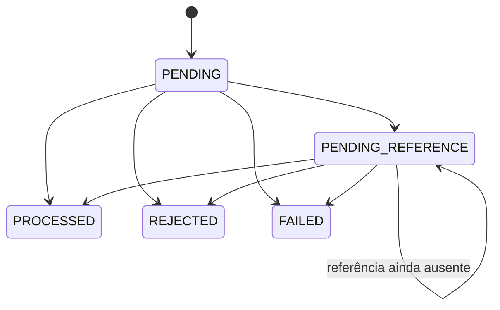

# Regras de negócio

> Decisão relacionada: [ADR 0009](../adr/0009-out-of-order-references-as-pending-state.md) (referências fora de ordem).

## Máquina de estados

`PROCESSED`, `REJECTED` e `FAILED` são terminais. Tentar transicionar a partir deles lança `InvalidTransactionStateError` (erro de programação), e o banco também bloqueia o `UPDATE`. `OPENING` é interno: nasce `PROCESSED` na criação da wallet e não é aceito por HTTP nem pela fila.

`WagerSettlement` (`src/domain/wagering/wager-settlement.ts`) é o domain service que aplica uma transação. Ele valida tudo antes de qualquer efeito colateral, então uma rejeição nunca deixa a wallet num estado intermediário. Rejeição de negócio não é exceção: vira status `REJECTED` com `failureCode`, é persistida e é auditável.

## Regras por tipo

| `kind`     | Efeito no saldo                   | Valor                  | Referência                                      |
| ---------- | --------------------------------- | ---------------------- | ----------------------------------------------- |
| `BET`      | débito                            | positivo               | —                                               |
| `WIN`      | crédito                           | positivo               | opcional e informativa (gravada, não resolvida) |
| `LOSS`     | nenhum (registra o fim da rodada) | pode ser `0.00`        | —                                               |
| `REFUND`   | crédito                           | igual ao da referência | obrigatória; precisa ser uma `BET`              |
| `ROLLBACK` | o inverso da referência           | igual ao da referência | obrigatória; `BET`, `WIN` ou `REFUND`           |

A referência precisa ser do mesmo provedor, jogador, wallet, moeda e rodada.

## Taxonomia de `failureCode`

| Código                        | Quando                                                        | Ação esperada do provedor    |
| ----------------------------- | ------------------------------------------------------------- | ---------------------------- |
| `INSUFFICIENT_FUNDS`          | `BET` sem saldo                                               | desistir                     |
| `REVERSAL_INSUFFICIENT_FUNDS` | `ROLLBACK` deixaria o saldo negativo                          | escalar para operação manual |
| `CURRENCY_MISMATCH`           | moeda diferente da wallet                                     | corrigir payload             |
| `WALLET_PLAYER_MISMATCH`      | wallet não pertence ao `playerId`                             | corrigir payload             |
| `REFERENCE_NOT_FOUND`         | referência não chegou dentro do prazo                         | investigar                   |
| `REFERENCE_NOT_PROCESSED`     | referência existe mas foi `REJECTED`/`FAILED`                 | desistir                     |
| `REFERENCE_MISMATCH`          | referência de outro provider, player, wallet, moeda ou rodada | corrigir payload             |
| `INVALID_REFERENCE_KIND`      | `REFUND` de não-`BET`; `ROLLBACK` de `LOSS`/`ROLLBACK`        | corrigir payload             |
| `REFERENCE_AMOUNT_MISMATCH`   | valor diferente da referência                                 | corrigir payload             |
| `ALREADY_REVERSED`            | referência já revertida                                       | desistir (já está feito)     |
| `PROCESSING_FAILED`           | erro permanente de infraestrutura (`FAILED`)                  | investigar                   |

O teste de propriedades (`test/unit/domain/settlement.property.test.ts`) gera sequências aleatórias de operações, incluindo referências inválidas e reversões repetidas, e verifica as invariantes de saldo e de reversão depois de cada passo.

## Interpretações adotadas

- **Uma referência é revertida no máximo uma vez, por qualquer tipo.** O enunciado fala em "pelo mesmo tipo de operação"; ao pé da letra, um `REFUND` e depois um `ROLLBACK` da mesma `BET` creditariam a aposta duas vezes. Desfazer um `REFUND` continua possível com um `ROLLBACK` apontando para o próprio `REFUND`. Ver [ADR 0010](../adr/0010-a-reference-can-be-reversed-at-most-once.md).
- A referência do `WIN` é opcional e informativa: é gravada, mas não é resolvida nem bloqueante.
- `LOSS` aceita valor `0.00`; os demais tipos exigem valor positivo.
- `ROLLBACK` inverte a direção da referência (`BET` vira crédito; `WIN` e `REFUND` viram débito).
- Rejeições por `WALLET_PLAYER_MISMATCH` e `CURRENCY_MISMATCH` não gravam nem devolvem o saldo da wallet, para não expor o saldo de outro jogador.
- A wallet referenciada precisa existir: um `walletId` desconhecido responde `404` (ou vai para a DLQ, na fila) e não é persistido, porque não há wallet a que associar a transação.

## Referências fora de ordem

`REFUND`/`ROLLBACK` cuja referência não existe (ou ainda não é terminal) vira `PENDING_REFERENCE` com `next_reference_check_at`. Um worker em cada instância busca as vencidas, trava a wallet e reaplica a mesma regra de domínio. Várias instâncias podem tentar a mesma transação: o lock da wallet as serializa, e a segunda encontra o status já alterado.

Política: **10 tentativas, backoff exponencial de 2 s até o teto de 5 min (cerca de 18 min no total)**. Uma referência fora de ordem costuma chegar em segundos (reordenação de fila); 18 minutos cobrem atraso de fila e reenvio do provedor sem manter transações penduradas por horas. Esgotado o limite: `REJECTED` com `REFERENCE_NOT_FOUND` e evento `WagerTransactionRejected`. `WagerTransactionPendingReference` é emitido apenas na primeira transição, não a cada nova tentativa.
