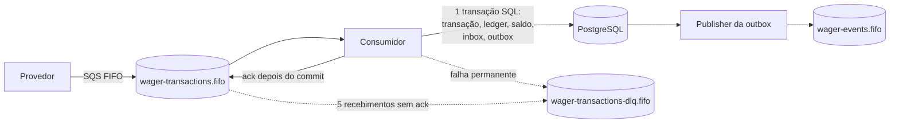

# Mensageria

> Contrato público em [api/messaging.md](../api/messaging.md). Decisões relacionadas: [ADR 0008](../adr/0008-transactional-outbox-and-inbox.md) (outbox e inbox) e [ADR 0015](../adr/0015-bounded-retention-for-inbox-and-outbox.md) (retenção).

## Consumidor SQS

`src/interfaces/sqs/wager-transaction-consumer.ts`

- Long polling na fila FIFO com 4 loops por instância (`SQS_CONSUMER_POLLERS`). Mensagens do mesmo `MessageGroupId` (wallet) são processadas em ordem; grupos diferentes, em paralelo. O FIFO nunca entrega o mesmo grupo a dois receptores ao mesmo tempo.
- A inbox `(consumerName, messageId)` é gravada **na mesma transação** da aplicação financeira. Redelivery vira replay; o mesmo `messageId` com outro payload é falha permanente (`INBOX_PAYLOAD_MISMATCH`).
- **`DeleteMessage` só depois do commit.** Se o processo morre entre o commit e o ack, a mensagem volta depois do visibility timeout (30 s) e a inbox a reconhece. O pior caso é processamento duplicado detectado, nunca efeito financeiro duplicado.

| Erro        | Exemplo                                                                                                     | Tratamento                                                                                                                                       |
| ----------- | ----------------------------------------------------------------------------------------------------------- | ------------------------------------------------------------------------------------------------------------------------------------------------ |
| Negócio     | `REJECTED`, `PENDING_REFERENCE`                                                                             | ack                                                                                                                                              |
| Permanente  | JSON inválido, kind desconhecido ou `OPENING`, valor inválido, wallet inexistente, conflito de idempotência | envia à DLQ com `failureCode` como atributo e faz ack, sem gastar tentativas                                                                     |
| Transitório | banco indisponível, deadlock, timeout de lock, erro desconhecido                                            | sem ack; visibilidade ajustada com backoff (2 s, 4 s, 8 s... até 60 s); mensagens seguintes do mesmo grupo são devolvidas para preservar a ordem |

Depois de 5 recebimentos sem ack, a redrive policy do SQS move a mensagem para a DLQ. Erros desconhecidos são tratados como transitórios de propósito: na dúvida, é melhor tentar de novo (e acabar na DLQ pela redrive policy) do que descartar uma transação financeira.

**Encerramento.** Em `SIGTERM`, o Nest chama `beforeApplicationShutdown`: o consumidor aborta o long poll, conclui e confirma as mensagens em andamento, e só depois o ORM é fechado. O que estava recebido e não confirmado volta à fila pelo visibility timeout.

## Transactional outbox

`src/application/messaging/publish-outbox-events.ts` e `src/infrastructure/persistence/mikro-orm-outbox-store.ts`

- Os eventos são gravados em `outbox_messages` na mesma transação da mudança financeira. Não existe janela em que o saldo mudou e o evento se perdeu, nem evento de algo que sofreu rollback.
- O publisher seleciona lotes com `FOR UPDATE SKIP LOCKED`: vários publishers (um por instância) trabalham em paralelo sem pegar a mesma linha.
- **Ordem por wallet.** O publisher reivindica uma wallet travando a mensagem mais antiga ainda não publicada dela e, na mesma transação, leva as próximas, até 20, em ordem. Enquanto a primeira estiver travada e não publicada, nenhum outro publisher pega as seguintes. Então nem uma falha de publicação nem publishers concorrentes fazem um evento posterior sair antes de um anterior da mesma wallet.
- A publicação usa `SendMessageBatch` (10 eventos por chamada; o FIFO preserva a ordem por grupo dentro do lote). Se uma entrada falha, ela e as seguintes da mesma wallet ficam pendentes e saem depois, na ordem.
- O lock é mantido durante o envio ao SQS. Se o processo morre, a transação faz rollback e outra instância republica: entrega at-least-once. A publicação usa `MessageDeduplicationId = eventId`, e o envelope carrega `eventId` e `walletVersion` para consumidores deduplicarem e ordenarem.
- Falha ao publicar: `attempts++`, `last_error` e próximo envio com backoff de 1 s até 60 s.
- O contexto de trace do produtor é gravado na coluna `headers` e vira o atributo `traceparent` da mensagem.

O teste de carga mostrou o efeito de cada uma dessas escolhas no atraso da outbox: de 27 s para menos de 1 s (ver `load-test/REPORT.md`).

Os eventos vão para `wager-events.fifo` (`MessageGroupId = walletId`), uma decisão desta implementação, já que o enunciado não define o destino.

## Retenção de inbox e outbox

`src/application/maintenance/purge-expired-messages.ts`

Um worker por instância (`RETENTION_INTERVAL_MS`, padrão 10 min) apaga a outbox publicada há mais de `OUTBOX_RETENTION_HOURS` (72 h) e a inbox processada há mais de `INBOX_RETENTION_DAYS` (7 dias).

- Linhas pendentes (`published_at IS NULL`, `processed_at IS NULL`) nunca são apagadas.
- Cada lote é `DELETE ... WHERE id IN (SELECT id ... LIMIT n FOR UPDATE SKIP LOCKED)`: transações curtas, sem disputa entre instâncias e sem bloquear o publisher. O worker repete enquanto o lote vier cheio.
- Índices parciais (`outbox_published_at_idx`, `inbox_processed_at_idx`) cobrem só as linhas elegíveis, sem custo para a inserção de pendentes.
- A janela da inbox é o horizonte da deduplicação de mensagens: precisa ser bem maior que qualquer reentrega do SQS. Mesmo depois que ela expira, a transação continua protegida pela chave de idempotência em `wager_transactions`, que nunca é apagada.
